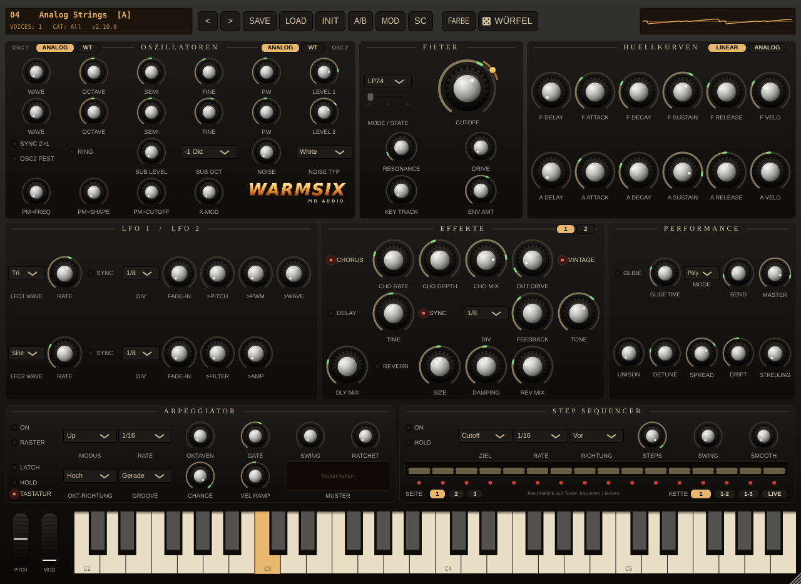

  

<h1 align="center">WarmSix</h1>

<b>Virtuell-analoger Polysynth · Virtual analog polysynth</b> 
MR Audio · AU · VST3 · CLAP · Standalone · macOS · Windows · Linux

  <a href="https://github.com/MartinRie/WarmSix-Releases/releases/latest"><b>⬇ Neueste Version herunterladen · Download latest version</b></a>

<a href="#deutsch">Deutsch</a> · <a href="#english">English</a>

---

## 🇩🇪 Deutsch

**WarmSix** ist ein virtuell-analoger Polysynth im Geist der volldiskreten Analog-Polys der späten 70er und frühen 80er Jahre: **eine Funktion, ein Regler**, keine Untermenüs. Er klingt warm, ein bisschen unstet und lebendig wie ein echtes Gerät. Gebaut wurde er für EBM, Synthpop und Dark Electro, er kann aber auch Flächen, Glocken, Bässe und Perkussion.

WarmSix ist **kostenlos**. Er wird ohne Gewähr weitergegeben.

### Was drin ist

**Klangerzeugung**
- 16 Stimmen, Unison bis 5-fach mit Detune und Stereobreite
- 2 Oszillatoren mit stufenloser Wellenform (Säge → Puls → Dreieck → Sinus), PWM, Sync, Ringmodulator
- **Wavetables** mit 16 eigenen Tabellen (Formanten, Glocke, Metall, Orgel, Bitcrush …) und eigene Tabellen per Drag & Drop
- **X-MOD** (Through-Zero-FM) und PolyMod für Glocken, Metall und Klong
- Sub-Oszillator, weißes und rosa Rauschen
- Analoger Drift und **STREUUNG**, damit jede Stimme etwas anders klingt
- 2× Oversampling gegen Aliasing

**Filter und Hüllkurven**
- Ladder-Filter (24/12 dB Tiefpass, Hochpass, Bandpass) mit Drive
- Zweites Filter mit 12 dB, das stufenlos von Tiefpass über Kerbe zu Hochpass blendet, plus Bandpass
- 2 ADSR-Hüllkurven mit Delay, Anschlagsdynamik, linearer oder analoger Kurvenform

**Modulation**
- 2 LFOs mit Host-Sync und Fade-In
- **Modulationsmatrix als Raster**: 11 Quellen × 12 Ziele (LFO, Hüllkurven, Anschlag, Aftertouch, Modrad, Taste, Zufall, Sidechain, Sequencer)
- Ringe an den Reglern zeigen live, was gerade moduliert wird
- **Sidechain**: Pumpen zur Kick (externer Eingang) oder im Songtempo

**Arpeggiator und Step-Sequencer**
- Arpeggiator mit 11 Modi, Oktaven, Swing, Ratchet, Chance und Rhythmus-Mustern mit Pausen, Akzenten und Bindungen
- Step-Sequencer mit 3 Seiten à 16 Schritten als Modulationsspur, oder im **Noten-Modus** mit Ton, Länge und Anschlag je Schritt
- Skalen und Akkorde je Schritt, Würfel für Variationen
- Muster als MIDI direkt in die DAW ziehen

**Effekte**
- Seite 1: Ensemble-Chorus, Tape-Delay mit Sättigung, Hall, Ausgangs-Sättigung und Vintage-Patina
- Seite 2: **Phaser** mit 4 bis 12 Stufen und **Bitcrusher** (Bits und Abtastrate), wahlweise vor oder nach den Effekten

**Presets und Bedienung**
- 110 eingebaute Werkspresets und eine Bank mit 446 Presets
- 11 Kategorien: Bass, Lead, Pad, Strings, Brass, Keys, Pluck, Glocke, Sequenz, Perkussion, FX
- **Patch-Würfel**: neuer Zufallsklang passend zur Kategorie oder den aktuellen Klang leicht bzw. stark verändern
- Preset-Browser mit Suche, A/B-Vergleich, Rückgängig/Wiederholen (Cmd/Strg+Z), MIDI-Learn
- 7 Farbschemata, die Bildschirmtastatur lässt sich einklappen
- Hinweis im Display, wenn es eine neue Version gibt

### Download und Installation

Unter **[Releases](https://github.com/MartinRie/WarmSix-Releases/releases/latest)** liegt für jedes System ein Paket:

| System | Datei | Enthält |
|---|---|---|
| **macOS** 11 oder neuer (Apple Silicon und Intel) | `WarmSix-x.y.z-Mac.zip` | AU, VST3, CLAP, App, Presets |
| **Windows** 10/11, 64 Bit | `WarmSix-x.y.z-Windows.zip` | VST3, CLAP, App, Presets |
| **Linux** 64 Bit (x86_64) | `WarmSix-x.y.z-Linux.tar.gz` | CLAP, VST3, App, Presets |

1. Paket entpacken.
2. Das Installationsprogramm starten:
   - **Mac:** Doppelklick auf **„WarmSix installieren“**
   - **Windows:** Doppelklick auf **„WarmSix installieren“**
   - **Linux:** `./warmsix-installieren.sh` ausführen
3. Auswählen, was installiert werden soll.
4. Im Musikprogramm die Plugin-Liste neu einlesen.

Auf dem Mac brauchst du kein Passwort. Unter Windows fragt das System einmal nach Administratorrechten für die Plugins. Unter Linux brauchst du kein sudo.

Jedem Paket liegen eine Anleitung (`LIESMICH.pdf`, unter Linux `LIESMICH-Linux.txt`) und die `Bedienungsanleitung.pdf` bei. Zum Entfernen gibt es **„WarmSix entfernen“**; deine eigenen Presets bleiben dabei erhalten.

> **Hinweis:** Die Dateien sind nicht von Apple oder Microsoft signiert.
> - **Mac:** Erscheint eine Warnung, mit Rechtsklick auf die Datei → *Öffnen* starten.
> - **Windows:** Zeigt SmartScreen „Der Computer wurde durch Windows geschützt“, auf *Weitere Informationen* → *Trotzdem ausführen* klicken.

### Updates

WarmSix fragt beim Start kurz hier nach, ob es eine neuere Version gibt. Dabei wird nichts gesendet und nichts automatisch installiert. Gibt es eine neue Version, erscheint im Display **„▲ UPDATE“**; ein Klick darauf öffnet diese Seite. Die Abfrage lässt sich im Menü abschalten.

### Fehler und Wünsche

Fehler gefunden oder eine Idee? Gern über **[Issues](https://github.com/MartinRie/WarmSix-Releases/issues)** oder direkt bei mir melden.

---

## 🇬🇧 English

**WarmSix** is a virtual analog polysynth inspired by the fully discrete analog polys of the late '70s and early '80s: **one function, one knob**, no menu diving. It sounds warm, slightly unstable and alive, like a real instrument. It was made for EBM, synthpop and dark electro, but it also does pads, bells, basses and percussion.

WarmSix is **free**. It is provided as is, without warranty.

> The user interface and the manual are in German. Most controls use standard synth terms (CUTOFF, ATTACK, RATE …), so they are easy to follow.

### Features

**Sound engine**
- 16 voices, up to 5× unison with detune and stereo spread
- 2 oscillators with continuous waveform (saw → pulse → triangle → sine), PWM, sync, ring modulator
- **Wavetables** with 16 built-in tables (formants, bell, metal, organ, bitcrush …) and your own tables via drag & drop
- **X-MOD** (through-zero FM) and PolyMod for bells, metal and clang
- Sub oscillator, white and pink noise
- Analog drift and **voice variance**, so every voice sounds a little different
- 2× oversampling against aliasing

**Filters and envelopes**
- Ladder filter (24/12 dB low-pass, high-pass, band-pass) with drive
- Second 12 dB filter that morphs continuously from low-pass through notch to high-pass, plus band-pass
- 2 ADSR envelopes with delay, velocity, and linear or analog curve shape

**Modulation**
- 2 LFOs with host sync and fade-in
- **Grid modulation matrix**: 11 sources × 12 destinations (LFOs, envelopes, velocity, aftertouch, mod wheel, key, random, sidechain, sequencer)
- Rings on the knobs show live what is being modulated
- **Sidechain**: pump to your kick (external input) or in song tempo

**Arpeggiator and step sequencer**
- Arpeggiator with 11 modes, octaves, swing, ratchet, chance and rhythm patterns with rests, accents and ties
- Step sequencer with 3 pages of 16 steps as a modulation track, or in **note mode** with pitch, length and velocity per step
- Scales and chords per step, dice for variations
- Drag patterns into your DAW as MIDI

**Effects**
- Page 1: ensemble chorus, tape delay with saturation, reverb, output drive and vintage character
- Page 2: **phaser** with 4 to 12 stages and **bitcrusher** (bit depth and sample rate), placed before or after the effects

**Presets and workflow**
- 110 built-in factory presets plus a bank of 446 presets
- 11 categories: bass, lead, pad, strings, brass, keys, pluck, bell, sequence, percussion, FX
- **Patch dice**: a new random sound that fits the category, or a light or strong variation of the current sound
- Preset browser with search, A/B compare, undo/redo (Cmd/Ctrl+Z), MIDI learn
- 7 colour schemes, collapsible on-screen keyboard
- Update notice in the display when a new version is available

### Download and installation

Each **[release](https://github.com/MartinRie/WarmSix-Releases/releases/latest)** has one package per system:

| System | File | Contains |
|---|---|---|
| **macOS** 11 or later (Apple Silicon and Intel) | `WarmSix-x.y.z-Mac.zip` | AU, VST3, CLAP, app, presets |
| **Windows** 10/11, 64-bit | `WarmSix-x.y.z-Windows.zip` | VST3, CLAP, app, presets |
| **Linux** 64-bit (x86_64) | `WarmSix-x.y.z-Linux.tar.gz` | CLAP, VST3, app, presets |

1. Extract the package.
2. Run the installer:
   - **Mac:** double-click **"WarmSix installieren"** (install)
   - **Windows:** double-click **"WarmSix installieren"** (install)
   - **Linux:** run `./warmsix-installieren.sh`
3. Choose what to install.
4. Rescan the plugin list in your DAW.

On the Mac no password is needed. On Windows the system asks once for administrator rights for the plugins. On Linux no sudo is needed.

Every package includes a guide (`LIESMICH.pdf`, on Linux `LIESMICH-Linux.txt`) and the manual (`Bedienungsanleitung.pdf`). To uninstall, use **"WarmSix entfernen"**; your own presets are kept.

> **Note:** The files are not signed by Apple or Microsoft.
> - **Mac:** if you see a warning, right-click the file and choose *Open*.
> - **Windows:** if SmartScreen says "Windows protected your PC", click *More info* → *Run anyway*.

### Updates

At startup WarmSix briefly checks this page for a newer version. Nothing is sent and nothing is installed automatically. If there is a new version, the display shows **"▲ UPDATE"**; clicking it opens this page. The check can be turned off in the menu.

### Bugs and ideas

Found a bug or have an idea? Please open an **[issue](https://github.com/MartinRie/WarmSix-Releases/issues)** or contact me directly.

---

WarmSix · © MR Audio · Rostock

